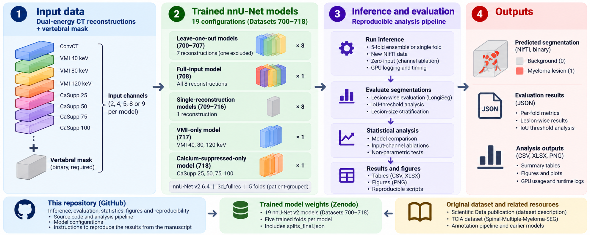

# Benchmarking Spectral Reconstructions (VMI and Calcium-Suppressed) for Multiple Myeloma Segmentation on Dual-Energy CT

> **Note:** this repository is a companion to the paper. It documents **how the reported results were generated** (inference, evaluation, statistics, figures) and **how to run the trained nnU-Net models** in general. It is not a training tutorial: the models were trained with standard [nnU-Net](https://github.com/MIC-DKFZ/nnUNet) (`3d_fullres`, 5-fold cross-validation) and **the trained weights for all 19 benchmark models are distributed separately on Zenodo (record pending publication)**. The patient-grouped cross-validation split is included in `results/splits_final.json`.

Code, trained-model configurations, and results accompanying the paper *Benchmarking Spectral Reconstructions (VMI and Calcium-Suppressed) for Multiple Myeloma Segmentation on Dual-Energy CT*.
The study evaluates how different dual-energy CT image series (conventional CT, virtual monoenergetic images, calcium-suppressed images) contribute to nnU-Net segmentation of osteolytic spinal multiple myeloma (MM) lesions: 19 models (Datasets 700–718), 5-fold cross-validation, input-channel ablations (leave-one-out, single-input, zero-input), lesion-size and IoU-threshold sensitivity analyses, statistical tests and computational cost.

**Authors:** Michal Nohel<sup>1,*</sup>, Vlastimil Valek<sup>2,3</sup>, Roman Jakubicek<sup>1</sup>, Marek Dostal<sup>2,4</sup>, Jiri Chmelik<sup>1</sup>

**Affiliations:**

<sup>1</sup> Department of Biomedical Engineering, Faculty of Electrical Engineering and Communication, Brno University of Technology, Brno, Czech Republic<br>
<sup>2</sup> Department of Radiology and Nuclear Medicine, University Hospital Brno, Brno, Czech Republic<br>
<sup>3</sup> Department of Radiology and Nuclear Medicine, Faculty of Medicine, Masaryk University, Brno, Czech Republic<br>
<sup>4</sup> Department of Biophysics, Masaryk University, Brno, Czech Republic

<sup>*</sup> Corresponding author: Michal Nohel (xnohel04@vutbr.cz)

## Benchmark workflow



*Conceptual overview of the benchmarking workflow. Input volumes and segmentation masks are schematic illustrations, not patient CT images or measured results. Trained model weights are distributed separately via Zenodo.*

## Trained models and training data format

**Download the trained models:** The weights for **all 19 nnU-Net v2 models (Datasets 700–718), including five trained folds per model**, are distributed in a **separate Zenodo archive**: **a separate Zenodo record (pending publication)**. **The trained weights are not stored in this GitHub repository.** The Zenodo archive also contains `splits_final.json`.

**Training data format:** All 19 models were **trained on 3D NIfTI volumes (`.nii.gz`)**, not directly on DICOM files. Each CT reconstruction was provided as a separate nnU-Net input channel, together with a **binary vertebral segmentation mask as the required final input channel**. For inference, supply aligned NIfTI files in the exact channel order specified by each model's `dataset.json` (see [Input data and output segmentation](#input-data-and-output-segmentation) and [Run a trained model on new data](#run-a-trained-model-on-new-data)).

## Resources

### This benchmarking study

| Resource | Link / status |
|----------|---------------|
| Benchmarking manuscript | *Benchmarking Spectral Reconstructions (VMI and Calcium-Suppressed) for Multiple Myeloma Segmentation on Dual-Energy CT*. Manuscript in preparation for submission to *Medical Image Analysis (MEDIA)*. |
| Trained models (Datasets 700–718; five folds each) | Separate Zenodo record, pending publication (also includes `splits_final.json`). |
| Benchmarking scripts, evaluation outputs and figures | This repository; see [Repository structure](#repository-structure). |

### Original dataset and associated resources

| Resource | Link |
|----------|------|
| Dataset publication (*Scientific Data*) | [doi:10.1038/s41597-026-08061-x](https://doi.org/10.1038/s41597-026-08061-x) |
| Spinal-Multiple-Myeloma-SEG dataset (TCIA) | [doi:10.7937/k4qv-hh78](https://doi.org/10.7937/k4qv-hh78) |
| Dataset preparation, annotations and original pipeline | [MISAG-BUT/Spinal-Multiple-Myeloma-SEG](https://github.com/MISAG-BUT/Spinal-Multiple-Myeloma-SEG) |
| Earlier trained models used for dataset preparation | [Zenodo record 18598645](https://zenodo.org/records/18598645) |
| End-to-end prediction using the original pipeline | [run_prediction_of_nnUNet_networks_on_new_data.py](https://github.com/MISAG-BUT/Spinal-Multiple-Myeloma-SEG/blob/main/run_prediction_of_nnUNet_networks_on_new_data.py) |

### External software and dependencies

| Resource | Link |
|----------|------|
| nnU-Net | [MIC-DKFZ/nnUNet](https://github.com/MIC-DKFZ/nnUNet) |
| LongiSeg (evaluation code adapted in this repository) | [MIC-DKFZ/LongiSeg](https://github.com/MIC-DKFZ/LongiSeg); see [third_party/longiseg](third_party/longiseg/README.md) |

## Repository structure

```
├── config.py / config.sh          # central paths (python / bash), overridable by environment variables
├── pyproject.toml, uv.lock        # analysis environment (uv)
├── environment/                   # nnU-Net + LongiSeg environment for GPU work
├── third_party/longiseg/          # patch + docs for our LongiSeg modifications
├── inference/                     # 5-fold / zero-input inference with timing and GPU logging
├── evaluation/                    # lesion-wise evaluation (LongiSeg_evaluate_folder), IoU-threshold analysis
├── analysis/                      # statistics, tables, figures, GPU usage, model configurations
└── results/
    ├── full_models/               # per-fold evaluation JSONs of models 700-718
    ├── zero_input_models/         # per-fold evaluation JSONs of the zero-input (channel ablation) analysis
    ├── iou_threshold_analysis_full_models/
    ├── gpu_logs/, inference_logs/ # nvidia-smi and runtime logs
    ├── splits_final.json          # 5-fold patient-level cross-validation split
    ├── tables/                    # all tables (CSV + XLSX), incl. statistical_analysis/ and model_configuration/
    └── figures/                   # final figures
```

Evaluation JSONs exist for three lesion-size filters: `longi_summary_all`, `longi_summary_larger_than_0_3_cubic_cm`, `longi_summary_larger_than_0_5_cubic_cm`.
## Models

| ID | CT reconstruction inputs | Total channels (including vertebral mask) |
|----|--------------------------|------------------------------------------|
| 700–707 | Leave-one-out: seven of eight CT reconstructions, excluding one reconstruction per model (ConvCT, VMI 40/80/120, or CaSupp 25/50/75/100, respectively) | 8 |
| 708 | All eight CT reconstructions | 9 |
| 709–716 | One CT reconstruction per model: ConvCT, VMI 40/80/120, or CaSupp 25/50/75/100, respectively | 2 |
| 717 | All three VMI reconstructions | 4 |
| 718 | All four CaSupp reconstructions | 5 |

**All 19 models were trained using 3D NIfTI (`.nii.gz`) inputs**, with one file per CT reconstruction channel and a binary vertebral mask as the final input channel. All models used the same nnU-Net v2 `3d_fullres` architecture, trainer (`nnUNetTrainer`, 1,000 epochs), and optimization settings. The number of input channels varied according to the selected CT reconstructions, resulting in only minor differences in parameter count (at most 0.019%). The seven-stage 3D U-Net architecture uses encoder widths of 32, 64, 128, 256, 320, 320, and 320; see `results/tables/model_configuration/` for the model configurations and parameter counts.

### Input data and output segmentation

**Input format:** The lesion segmentation networks **were trained on** 3D CT volumes in NIfTI format (`.nii.gz`). Each CT reconstruction is supplied as a separate input channel. In addition, **every model requires a binary vertebral (spine) segmentation mask** as the final input channel, encoded as `0` for background and `1` for vertebrae. This is an anatomical input to the lesion segmentation network, **not the lesion ground-truth mask**. All channels must represent the same examination and have matching spatial geometry. The study used manually corrected vertebral masks.

The model predicts a separate binary multiple myeloma lesion segmentation (`0` = background, `1` = lesion). The number and order of input channels depend on the selected model and must match its `dataset.json`.

### Methodological considerations

- **Vertebral-mask quality:** The benchmark used manually corrected vertebral masks; results may differ when automatically generated masks are used on new examinations.
- **Reference annotation:** Lesion annotations were created and reviewed on VMI 40 keV images. This may favor configurations containing VMI 40 keV and should be considered when interpreting modality comparisons.
- **Validation:** The benchmark used patient-grouped five-fold cross-validation on 72 examinations from 67 patients. No independent external validation cohort was evaluated.
- **Different ablations:** Leave-one-out models were trained without the excluded CT reconstruction; in the zero-input experiments, an existing trained model was evaluated with one image channel set to zero at inference. These analyses are not interchangeable.

## Run a trained model on new data

After the model archive is published, download the trained models from its Zenodo record (see [Resources](#resources)) and place them in a folder, e.g. `nnUNet_results/Dataset708_MM_Lesion_seg_all_together/nnUNetTrainer__nnUNetPlans__3d_fullres`
(contains `fold_0 … fold_4`, `plans.json`, `dataset.json`). Install nnU-Net ([installation instructions](https://github.com/MIC-DKFZ/nnUNet/blob/master/documentation/installation_instructions.md); we used `nnunetv2 2.6.4`):

```bash
bash environment/setup_nnunet_env.sh cu126        # or install torch + nnU-Net manually
source .venv-nnunet/bin/activate
```

Input data must be NIfTI files (`.nii.gz`) following nnU-Net naming: `<case>_0000.nii.gz`, `<case>_0001.nii.gz`, …, with **one file per input channel**. Supply the CT reconstructions in the same channel order used during training (see `channel_names` in the model's `dataset.json`). **The final channel must contain the binary vertebral segmentation mask** (`0` = background, `1` = vertebrae), not a CT reconstruction or lesion label. All channels must have matching dimensions, spacing, orientation, and spatial alignment. nnU-Net applies its configured preprocessing during prediction.

For example, a single-reconstruction model (Datasets 709–716) expects two NIfTI files per case:

```text
Patient001_0000.nii.gz  # CT reconstruction used by the selected model
Patient001_0001.nii.gz  # binary vertebral segmentation mask (0 = background, 1 = vertebrae)
```

The full eight-reconstruction model (Dataset 708) expects nine NIfTI files per case:

```text
Patient001_0000.nii.gz  # first CT reconstruction
...
Patient001_0007.nii.gz  # eighth CT reconstruction
Patient001_0008.nii.gz  # binary vertebral segmentation mask (0 = background, 1 = vertebrae)
```

These examples illustrate channel numbering only: **always use the exact reconstruction order defined by `channel_names` in the selected model's `dataset.json`**. To run inference:

```bash
nnUNetv2_predict_from_modelfolder \
    -i INPUT_FOLDER \
    -o OUTPUT_FOLDER \
    -m /path/to/nnUNet_results/Dataset708_MM_Lesion_seg_all_together/nnUNetTrainer__nnUNetPlans__3d_fullres \
    -f 0 1 2 3 4      # five-fold ensemble; requires all five trained folds
```

`nnUNetv2_predict_from_modelfolder` does not require `nnUNet_raw/preprocessed/results` environment variables. The output is a lesion mask (`1` = MM lesion) for every case.
[inference/run_predictions.sh](inference/run_predictions.sh) shows the exact way the cross-validation predictions of all 19 models were produced for the paper.

### Complete ConvCT + VMI 40 keV example

For an end-to-end example on a new scan, use the [`run_prediction_of_nnUNet_networks_on_new_data.py` pipeline](https://github.com/MISAG-BUT/Spinal-Multiple-Myeloma-SEG/blob/main/run_prediction_of_nnUNet_networks_on_new_data.py) in the companion [Spinal-Multiple-Myeloma-SEG repository](https://github.com/MISAG-BUT/Spinal-Multiple-Myeloma-SEG). It accepts a ConvCT NIfTI and a VMI 40 keV NIfTI, segments the spine from ConvCT, then segments myeloma lesions from VMI 40 keV using the spine mask, and writes both segmentations. The companion repository's [README](https://github.com/MISAG-BUT/Spinal-Multiple-Myeloma-SEG/blob/main/README.md) documents environment setup, model downloads, and configuration.

After setting up that repository and downloading its required trained models, run:

```bash
python run_prediction_of_nnUNet_networks_on_new_data.py \
    --path_to_convCT_nifti /path/to/ConvCT.nii.gz \
    --path_to_VMI40_nifti /path/to/VMI40.nii.gz \
    --path_to_output_folder /path/to/output \
    --path_to_nnunet_results /path/to/Spinal-Multiple-Myeloma-SEG_nnUNet_models
```

Use corresponding ConvCT and VMI 40 keV volumes in NIfTI format, oriented in RAS as expected by the pipeline. The output is written to a patient-specific subfolder. **Choose a fresh output location or back up prior results first:** rerunning the script for the same patient removes that patient's existing working subfolder before recreating it. This model pipeline is for research and development, not clinical decision-making.

## Quick start: reproduce tables and figures (CPU only)

The evaluation results are included in `results/`, so the tables and figures can be regenerated without GPU, data or models.

```bash
curl -LsSf https://astral.sh/uv/install.sh | sh     # install uv (https://docs.astral.sh/uv/)
uv sync                                            # creates .venv (Python 3.12) from uv.lock

uv run python analysis/generate_tables.py          # statistics + tables -> results/tables   (run first)
uv run python analysis/generate_figures.py         # figures            -> results/figures
uv run python analysis/generate_figures_2.py       # larger, bolder figures -> results/figures_2
```

`generate_figures_2.py` is an independent styling variant for reviewing figure readability; it leaves the original figures and script unchanged.

Tables `gpu_analysis/` and `model_configuration/` additionally read the trained-model folders (`debug.json`, `plans.json`); this needs the Zenodo models placed in `$nnUNet_results`:

```bash
export nnUNet_results=/path/to/nnUNet_results
uv run python analysis/model_configurations.py
```

If these folders are missing, the corresponding scripts fail; the precomputed outputs are already in `results/tables`.
Use `MM_RESULTS_DIR=/other/path` to write/read results elsewhere.

## How the results were generated (GPU)

1. **Environment** – nnU-Net + modified LongiSeg:
   ```bash
   bash environment/setup_nnunet_env.sh cu126        # CUDA wheel tag of your system
   source .venv-nnunet/bin/activate
   source config.sh                                  # nnUNet_raw / nnUNet_preprocessed / nnUNet_results
   ```
2. **Data and models** – the data are from [TCIA](https://doi.org/10.7937/k4qv-hh78), converted to nnU-Net format (`Dataset700 … Dataset718` in `$nnUNet_raw`, channels as in the table above, with a binary vertebral mask (`0` = background, `1` = vertebrae) as the last input channel; lesion ground-truth labels are separate (`background=0`, `Lesions=1`)).
   Trained models (`$nnUNet_results`) are distributed separately; see the separate Zenodo model archive when published. The cross-validation split is also included in `results/splits_final.json` in this repository. Ground-truth labels per fold are expected in `$nnUNet_raw/MM_GT_DATA/labelsTr_fold_{0..4}`.
   Training itself is standard nnU-Net and is not part of this repository.
3. **Inference** – `bash inference/run_predictions.sh` (predicts the validation cases of every fold, logs time and GPU utilization into `results/`).
4. **Evaluation** – `bash evaluation/run_evaluation.sh` (Dice, NSD, HD95, lesion-wise F1, …; IoU threshold 0.1) and
   `bash evaluation/run_iou_threshold_analysis.sh` (IoU 0.05–0.90). For the lesion-size variants see [third_party/longiseg/README.md](third_party/longiseg/README.md).
5. **Analysis** – the two commands from *Quick start*.

All paths are configured centrally in [config.py](config.py) / [config.sh](config.sh).

## Hardware

Training (nnU-Net) used NVIDIA A40, NVIDIA L40 and NVIDIA Tesla V100 GPUs. Inference benchmarking was performed on an NVIDIA GeForce RTX 5080 (16 GB) workstation; see `results/tables/gpu_analysis/` for the reported timings and GPU measurements. These timing measurements cover nnU-Net inference, not the entire raw-data-to-segmentation workflow.

## Citation

If you use this repository or its results, please cite the relevant publications and dataset below. The associated benchmarking manuscript is in preparation for submission to *Medical Image Analysis (MEDIA)* and is not yet a published citable resource.

### Dataset paper (*Scientific Data*)

Nohel, M., Valek, V., Rohan, T., Stork, M., Jakubicek, R., Chmelik, J., Dostal, M. (2026).
**Spinal-Multiple-Myeloma-SEG: Segmentation of spinal multiple myeloma lesions in dual-energy CT**.  
*Scientific Data*.  
https://doi.org/10.1038/s41597-026-08061-x

```bibtex
@article{nohel2026spinalmm,
  author  = {Nohel, Michal and Valek, Vlastimil and Rohan, Tomas and Stork, Martin and Jakubicek, Roman and Chmelik, Jiri and Dostal, Marek},
  title   = {{Spinal-Multiple-Myeloma-SEG}: Segmentation of spinal multiple myeloma lesions in dual-energy {CT}},
  journal = {Scientific Data},
  year    = {2026},
  doi     = {10.1038/s41597-026-08061-x},
  url     = {https://doi.org/10.1038/s41597-026-08061-x}
}
```

### Dataset (TCIA)

Nohel, M., Valek, V., Rohan, T., Stork, M., Jakubicek, R., Chmelik, J., Dostal, M. (2026).
**Segmentation of spinal multiple myeloma lesions in dual-energy CT (Spinal-Multiple-Myeloma-SEG) (Version 1) [Dataset].**  
*The Cancer Imaging Archive*.  
https://doi.org/10.7937/k4qv-hh78

```bibtex
@misc{nohel2026tcia,
  author       = {Nohel, Michal and Valek, Vlastimil and Rohan, Tomas and Stork, Martin and Jakubicek, Roman and Chmelik, Jiri and Dostal, Marek},
  title        = {Segmentation of spinal multiple myeloma lesions in dual-energy {CT} ({Spinal-Multiple-Myeloma-SEG})},
  year         = {2026},
  version      = {1},
  publisher    = {The Cancer Imaging Archive},
  howpublished = {Dataset},
  doi          = {10.7937/k4qv-hh78},
  url          = {https://doi.org/10.7937/k4qv-hh78}
}
```

### Benchmarking manuscript (in preparation)

Nohel, M., Valek, V., Jakubicek, R., Dostal, M., Chmelik, J.  
**Benchmarking Spectral Reconstructions (VMI and Calcium-Suppressed) for Multiple Myeloma Segmentation on Dual-Energy CT.**  
Unpublished manuscript in preparation for submission to *Medical Image Analysis (MEDIA)*. No DOI is available yet.

### nnU-Net

Isensee, F., Jaeger, P. F., Kohl, S. A. A., Petersen, J., Maier-Hein, K. H. (2021).  
**nnU-Net: a self-configuring method for deep learning-based biomedical image segmentation.**  
*Nature Methods*, 18, 203–211.  
https://doi.org/10.1038/s41592-020-01008-z

```bibtex
@article{isensee2021nnunet,
  author  = {Isensee, Fabian and Jaeger, Paul F. and Kohl, Simon A. A. and Petersen, Jens and Maier-Hein, Klaus H.},
  title   = {{nnU-Net}: a self-configuring method for deep learning-based biomedical image segmentation},
  journal = {Nature Methods},
  volume  = {18},
  pages   = {203--211},
  year    = {2021},
  doi     = {10.1038/s41592-020-01008-z},
  url     = {https://doi.org/10.1038/s41592-020-01008-z}
}
```

The evaluation code also builds on [LongiSeg](https://github.com/MIC-DKFZ/LongiSeg); please acknowledge the original work as appropriate. Once the 19-model Zenodo archive is published, cite its Zenodo record and version-specific DOI when using the trained weights.

## Reproducibility and scope

The `results/` directory contains stored evaluation outputs used to regenerate the published tables and figures. Regenerating these summaries from the stored results is different from independently reproducing the original training, cross-validation inference and lesion evaluation, which additionally require the source data, trained models, compatible software and the documented fold split. Models and scripts are provided for research use; they have not been externally validated for clinical deployment.

## License

Apache License 2.0 – see [LICENSE](LICENSE). The LongiSeg patch is derived from Apache-2.0 licensed code by MIC-DKFZ.
