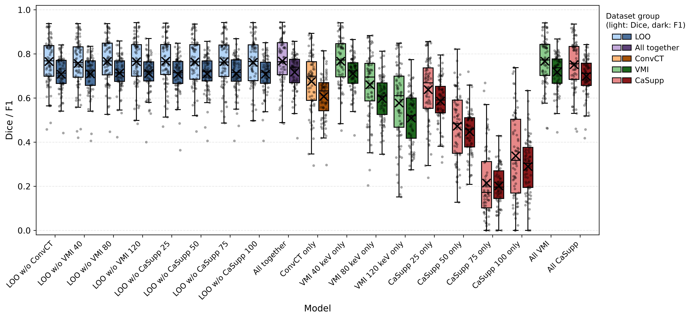

# Spinal MM analyses – multi-channel dual-energy CT segmentation of spinal multiple myeloma lesions

> **Note:** this repository is a companion to the paper. It documents **how the reported results were generated** (inference, evaluation, statistics, figures) and **how to run the trained nnU-Net models** in general. It is not a training tutorial: the models were trained with standard [nnU-Net](https://github.com/MIC-DKFZ/nnUNet) (`3d_fullres`, 5-fold cross-validation) and the trained models together with `splits_final.json` are available on Zenodo.

Code, trained-model configuration and results for the paper **"TODO: paper title"** (TODO: authors, journal, year).
The study evaluates how different dual-energy CT image series (conventional CT, virtual monoenergetic images, calcium-suppressed images) contribute to nnU-Net segmentation of osteolytic spinal multiple myeloma (MM) lesions: 19 models (Datasets 700–718), 5-fold cross-validation, input-channel ablations (leave-one-out, single-input, zero-input), lesion-size and IoU-threshold sensitivity analyses, statistical tests and computational cost.



## Links

| Resource | Link |
|----------|------|
| Paper | TODO |
| Dataset (TCIA, Spinal-Multiple-Myeloma-SEG) | [doi:10.7937/k4qv-hh78](https://doi.org/10.7937/k4qv-hh78) |
| Trained models (Zenodo) | TODO (Zenodo DOI) |
| Dataset / annotation pipeline code and models | [MISAG-BUT/Spinal-Multiple-Myeloma-SEG](https://github.com/MISAG-BUT/Spinal-Multiple-Myeloma-SEG) |
| nnU-Net | [MIC-DKFZ/nnUNet](https://github.com/MIC-DKFZ/nnUNet) |
| LongiSeg (evaluation code, modified here) | [MIC-DKFZ/LongiSeg](https://github.com/MIC-DKFZ/LongiSeg) – see [third_party/longiseg](third_party/longiseg/README.md) |

## Repository structure

```
├── config.py / config.sh          # central paths (python / bash), overridable by environment variables
├── pyproject.toml, uv.lock        # analysis environment (uv)
├── environment/                   # nnU-Net + LongiSeg environment for GPU work
├── third_party/longiseg/          # patch + docs for our LongiSeg modifications
├── inference/                     # 5-fold / zero-input inference with timing and GPU logging
├── evaluation/                    # lesion-wise evaluation (LongiSeg_evaluate_folder), IoU-threshold analysis
├── analysis/                      # statistics, tables, figures, GPU usage, model configurations
└── results/
    ├── full_models/               # per-fold evaluation JSONs of models 700-718
    ├── zero_input_models/         # per-fold evaluation JSONs of the zero-input (channel ablation) analysis
    ├── iou_threshold_analysis_full_models/
    ├── gpu_logs/, inference_logs/ # nvidia-smi and runtime logs
    ├── splits_final.json          # 5-fold patient-level cross-validation split
    ├── tables/                    # all tables (CSV + XLSX), incl. statistical_analysis/ and model_configuration/
    └── figures/                   # final figures
```

Evaluation JSONs exist for three lesion-size filters: `longi_summary_all`, `longi_summary_larger_than_0_3_cubic_cm`, `longi_summary_larger_than_0_5_cubic_cm`.
Patient IDs in the result files are anonymized.

## Models

| ID | Input channels (+ spine mask) |
|----|-------------------------------|
| 700–707 | leave-one-out: all 8 series except ConvCT / VMI 40 / VMI 80 / VMI 120 / CaSupp 25 / 50 / 75 / 100 |
| 708 | all 8 series (ConvCT, VMI 40/80/120, CaSupp 25/50/75/100) |
| 709–716 | single series (ConvCT, VMI 40, 80, 120, CaSupp 25, 50, 75, 100) |
| 717 | all VMI (40, 80, 120) |
| 718 | all CaSupp (25, 50, 75, 100) |

All models use the same nnU-Net `3d_fullres` architecture, trainer (`nnUNetTrainer`, 1000 epochs) and plans; they differ only in the number of input channels
(see `results/tables/model_configuration/`).

## Run a trained model on new data

Download the models from Zenodo (TODO link) and place them in a folder, e.g. `nnUNet_results/Dataset708_MM_Lesion_seg_all_together/nnUNetTrainer__nnUNetPlans__3d_fullres`
(contains `fold_0 … fold_4`, `plans.json`, `dataset.json`). Install nnU-Net ([installation instructions](https://github.com/MIC-DKFZ/nnUNet/blob/master/documentation/installation_instructions.md); we used `nnunetv2 2.6.4`):

```bash
bash environment/setup_nnunet_env.sh cu126        # or install torch + nnU-Net manually
source .venv-nnunet/bin/activate
```

Input images must be NIfTI files in nnU-Net naming: `<case>_0000.nii.gz`, `<case>_0001.nii.gz`, … one file per input channel, in the same channel order as the model was trained with
(see `channel_names` in the model's `dataset.json`; the last channel is the spine mask), resampling-free, same series as in the table above. Then:

```bash
nnUNetv2_predict_from_modelfolder \
    -i INPUT_FOLDER \
    -o OUTPUT_FOLDER \
    -m /path/to/nnUNet_results/Dataset708_MM_Lesion_seg_all_together/nnUNetTrainer__nnUNetPlans__3d_fullres \
    -f all            # use "0 1 2 3 4" for the 5-fold ensemble
```

`nnUNetv2_predict_from_modelfolder` does not require `nnUNet_raw/preprocessed/results` environment variables. The output is a lesion mask (`1` = MM lesion) for every case.
[inference/run_predictions.sh](inference/run_predictions.sh) shows the exact way the cross-validation predictions of all 19 models were produced for the paper.

## Quick start: reproduce tables and figures (CPU only)

The evaluation results are included in `results/`, so the tables and figures can be regenerated without GPU, data or models.

```bash
curl -LsSf https://astral.sh/uv/install.sh | sh     # install uv (https://docs.astral.sh/uv/)
uv sync                                            # creates .venv (Python 3.12) from uv.lock

uv run python analysis/generate_tables.py          # statistics + tables -> results/tables   (run first)
uv run python analysis/generate_figures.py         # figures            -> results/figures
```

Tables `gpu_analysis/` and `model_configuration/` additionally read the trained-model folders (`debug.json`, `plans.json`); this needs the Zenodo models placed in `$nnUNet_results`:

```bash
export nnUNet_results=/path/to/nnUNet_results
uv run python analysis/model_configurations.py
```

If these folders are missing, the corresponding scripts fail; the precomputed outputs are already in `results/tables`.
Use `MM_RESULTS_DIR=/other/path` to write/read results elsewhere.

## How the results were generated (GPU)

1. **Environment** – nnU-Net + modified LongiSeg:
   ```bash
   bash environment/setup_nnunet_env.sh cu126        # CUDA wheel tag of your system
   source .venv-nnunet/bin/activate
   source config.sh                                  # nnUNet_raw / nnUNet_preprocessed / nnUNet_results
   ```
2. **Data and models** – the data are from [TCIA](https://doi.org/10.7937/k4qv-hh78), converted to nnU-Net format (`Dataset700 … Dataset718` in `$nnUNet_raw`, channels as in the table above, last channel is the spine mask; labels `background=0`, `Lesions=1`).
   Trained models (`$nnUNet_results`) and `splits_final.json` come from Zenodo. Ground-truth labels per fold are expected in `$nnUNet_raw/MM_GT_DATA/labelsTr_fold_{0..4}`.
   Training itself is standard nnU-Net and is not part of this repository.
3. **Inference** – `bash inference/run_predictions.sh` (predicts the validation cases of every fold, logs time and GPU utilization into `results/`).
4. **Evaluation** – `bash evaluation/run_evaluation.sh` (Dice, NSD, HD95, lesion-wise F1, …; IoU threshold 0.1) and
   `bash evaluation/run_iou_threshold_analysis.sh` (IoU 0.05–0.90). For the lesion-size variants see [third_party/longiseg/README.md](third_party/longiseg/README.md).
5. **Analysis** – the two commands from *Quick start*.

All paths are configured centrally in [config.py](config.py) / [config.sh](config.sh).

## Hardware

Training (nnU-Net): NVIDIA A40 and Tesla V100 GPUs. Inference timing: see `results/tables/gpu_analysis/`.

## Citation

```bibtex
TODO: paper citation
```

Dataset:

> Nohel, M., Válek V., Rohan T., Štork M., Jakubíček R., Chmelík J., Dostál M. (2026) **Segmentation of spinal multiple myeloma lesions in dual-energy CT (Spinal-Multiple-Myeloma-SEG) (Version 1) [Dataset]**. The Cancer Imaging Archive. https://doi.org/10.7937/k4qv-hh78

Please also cite nnU-Net and LongiSeg (see the respective repositories).

## License

Apache License 2.0 – see [LICENSE](LICENSE). The LongiSeg patch is derived from Apache-2.0 licensed code by MIC-DKFZ.
